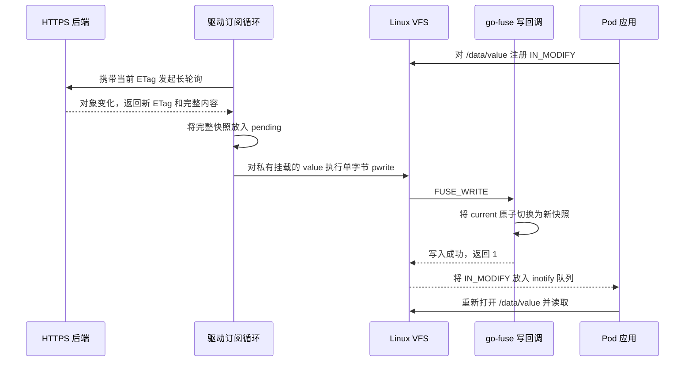

# ramvalue CSI

Linux Kubernetes CSI 节点驱动，使用 go-fuse v2。每个静态只读 PV 的 `volumeHandle` 选择一个后端对象。将 PVC 挂到 `/data` 后，应用通过 `/data/value` 读取对象，通过标准 inotify 监听更新。每个挂载目标独立订阅，单个对象上限为 4 MiB，支持空内容和二进制内容。

## 无 Kubernetes 的本机演示

同一个驱动二进制提供 `demo` 子命令，使用 go-fuse 和系统的 `fusermount3`（或 `fusermount`）挂载普通用户拥有的空目录。需要 Linux、可访问的 `/dev/fuse` 和 Go 1.26.2 或更新版本。下例的监听命令来自 `inotify-tools`。

在第一个终端进入仓库根目录，构建并启动演示。

```sh
go build -o /tmp/ramvalue-driver ./cmd/driver
mkdir -p "$HOME/ramvalue-demo"
/tmp/ramvalue-driver demo -mount "$HOME/ramvalue-demo" -interval 2s
```

在第二个终端以同一用户监听文件，每次收到事件后重新打开文件读取最新值。

```sh
file="$HOME/ramvalue-demo/value"
inotifywait -m -q -e modify --format '%e' "$file" |
  while read -r event; do
    printf '%s ' "$event"
    cat "$file"
  done
```

可以看到 `MODIFY revision 1`、`MODIFY revision 2` 等输出，起始序号取决于开始监听的时间。先用 Ctrl+C 停止监听，再在第一个终端按 Ctrl+C，驱动会卸载并保留原目录。

演示模式从 `revision 0` 开始，默认每 2 秒生成一个合成快照，复用 CSI 的 FUSE 写回调和内核通知路径。演示无需后端，也不申请生产驱动的进程锁页权限。实际 CSI 模式只在后端返回新 ETag 和完整内容后更新文件，`304` 心跳只会触发下一次订阅。

## 后端接口

在 DaemonSet 中配置 `BACKEND_URL`，例如 `https://backend.example.com/api`。驱动校验服务端 TLS 证书。私有 CA 可挂到驱动容器，并通过 `SSL_CERT_FILE` 指定 PEM 文件。当前客户端使用服务端 TLS 认证，后端访问权限由部署环境提供。已有其他协议的后端可实现 [Source 接口](internal/driver/node.go)。

| 请求 | 后端行为 |
| --- | --- |
| 首次 `GET /api/volumes/example` | 立即返回 `200`、带双引号的强 ETag（例如 `"42"`）和完整原始文件内容。首次读取成功后才发布挂载。 |
| 同一路径，携带 `If-None-Match: "42"` | 如果已有新版本，立即返回新 ETag 和完整内容；否则挂起请求，在内容变化时返回。 |
| 等待约 25 秒仍无变化 | 返回 `304` 作为心跳。驱动会重新订阅，单个 HTTP 请求超时为 40 秒。 |
| 请求失败或响应体不完整 | 已挂载的卷继续提供上次成功的快照，驱动使用原 ETag 重连，退避时间为 1 至 30 秒。 |

`volumeHandle` 允许 1 至 128 个 ASCII 字符，以字母或数字开头，后续可包含字母、数字、点、下划线和连字符。ETag 用作版本标识，内容变化时须同步更新。要发布空文件，返回新 ETag 和长度为零的 `200` 响应。`404` 按获取失败处理，因此后端删除对象时，现有挂载会继续保留最后一份快照。

## 部署与观察

节点需要 Linux 5.12 或更高版本、可用的 `/dev/fuse` 和支持双向挂载传播的 kubelet 目录。默认 kubelet 根目录是 `/var/lib/kubelet`，使用自定义目录时同步调整清单里的 hostPath、pods 的容器挂载路径和 registrar 的注册路径。

1. 用 `docker build -t ramvalue-csi:0.1.0 .` 构建镜像并加载到各节点，或推送到自己的镜像仓库并修改 DaemonSet 的镜像地址。
2. 将部署清单里的 `BACKEND_URL` 改为实际后端地址，确认该后端能提供对象 `example`。[节点驱动清单](deploy/driver.yaml)
3. 部署驱动、等待 registrar 完成注册，再创建静态 PV、PVC 和示例 Pod。[业务 Pod 示例](deploy/example.yaml)

```sh
kubectl apply -f deploy/driver.yaml
kubectl rollout status -n kube-system daemonset/ramvalue-csi
kubectl get csinode -o custom-columns='NODE:.metadata.name,DRIVERS:.spec.drivers[*].name'
kubectl apply -f deploy/example.yaml
kubectl wait -n default --for=condition=Ready pod/ramvalue-reader --timeout=120s
kubectl logs -n default -f ramvalue-reader
```

示例 Pod 启动后会执行 `inotifyd - /data/value:c`。保持日志窗口打开，通过后端自己的管理接口更新对象 `example` 的内容和 ETag。日志中应出现一行 `c    /data/value`，其中 `c` 表示 `IN_MODIFY`。要验证实际读取，可以先发布一个已知长度的测试值，再执行下面的命令。输出只有当前字节数。

```sh
kubectl exec -n default ramvalue-reader -- sh -c 'wc -c < /data/value'
```

## 核心实现

### 挂载与读取

kubelet 调用 `NodePublishVolume` 时，驱动先用 PV 的 `volumeHandle` 获取完整初值，再启动 go-fuse，在驱动私有目录中创建名为 `value` 的持久 inode。驱动用 `open_tree` 克隆挂载，用 `mount_setattr` 将克隆设为只读，最后用 `move_mount` 将其发布到 kubelet 的目标路径。容器运行时把这个目标挂进 Pod。私有路径和 Pod 路径指向同一个 inode，但挂载权限独立，因此驱动可以从私有路径发起写操作，Pod 只能读取。[卷发布与订阅](internal/driver/node.go) · [FUSE 挂载实现](internal/volume/fs.go)

每次只读打开 `value`，驱动都会把当时的内存快照绑定到这次打开的文件描述符。即使读取大文件要分多次 `read`，中途到来的更新也不会混入这次读取。卸载时，`NodeUnpublishVolume` 移除目标挂载、取消后端订阅并释放私有 FUSE 挂载。

### 后端更新如何触发 Pod 的 inotify



1. **后端唤醒长轮询。** 当对象版本与请求中的 ETag 相同时，后端保持请求挂起。一旦版本变化，后端立即返回完整快照。25 秒是建议的空闲心跳间隔，更新可以在此之前送达。驱动收到 `304` 时重新订阅，保留当前快照。[HTTPS 客户端](internal/backend/client.go)
2. **驱动让更新经过内核写路径。** 仅替换 Go 堆中的指针，内核观察不到文件写入。`Mount.Update` 把新快照放入 `pending`，随后从私有路径对 `value` 的偏移 0 执行一次 `WriteAt([]byte{0}, 0)`。即使新快照长度为零，内核也会处理这次单字节写入。[更新与写回调](internal/volume/fs.go)
3. **先切换内容，再产生事件。** 内核把写请求交给 `notifier.Write`。回调取出待发布快照，以 `current.Store(next)` 原子切换可见内容，然后返回写入成功。触发写操作的零字节不进入文件内容。Linux VFS 在成功的写路径上通过 fsnotify 投递 `IN_MODIFY`。由于两侧挂载共享 inode，监听 Pod 内文件的 watch 能收到事件；监听父目录 `/data` 的 watch 能收到带文件名 `value` 的事件。[真实挂载测试](internal/driver/node_linux_test.go)

### 应用怎样消费事件

先注册 watch，再打开并读取初值，可以避免在首次读取与开始监听之间漏掉变更。监听文件时处理 `IN_MODIFY` 即可。监听目录时还要匹配事件中的文件名 `value`。每次处理事件都应**重新打开文件**，因为对旧文件描述符执行 `seek(0)` 仍会读到旧快照。

事件表示“可以重新读取当前值”。如果处理事件前又发生了更新，重新打开时会读到更新的版本。Linux 可以合并连续事件，后端也可能跳过两次请求之间的中间版本。收到 `IN_Q_OVERFLOW` 时同样重新打开并读取当前值，以恢复同步。

## 明文的存储边界

- 驱动在首次连接后端前执行 `mlockall(MCL_CURRENT | MCL_FUTURE | MCL_ONFAULT)`，覆盖接收缓冲区、Go 堆与后续映射，同时设置 `PR_SET_DUMPABLE=0` 和 `RLIMIT_CORE=0`。任一调用失败都会终止启动。部署清单通过特权容器提供 FUSE 挂载和锁页所需权限。
- 明文只进入内存快照。读取使用 `FOPEN_DIRECT_IO` 绕过 FUSE 文件页缓存。驱动不创建数据文件、临时明文、磁盘缓存，也不把响应体写入日志。节点上的 CSI socket、挂载目录和 kubelet 卷元数据只承载通信与挂载信息。
- 应用读入明文后，应用自己的 swap、core dump、日志及文件写入需要单独控制。要求整台节点的明文均不落盘时，还需禁用或妥善控制节点休眠、内核转储和虚拟机内存快照，并约束业务应用及后端的明文处理。
- FUSE 连接属于驱动进程。驱动重启后，已有 Pod 中的旧挂载可能返回 `ENOTCONN`，需重建受影响的业务 Pod 以建立新挂载。维护节点或滚动升级驱动时应将此行为纳入安排。

## 本地验证

普通测试覆盖 HTTPS 条件请求、空版本、心跳、截断及超限响应。特权测试会创建真实 FUSE 挂载和额外的只读 bind mount，检查文件及目录的 inotify 事件、增长与缩短、清空、快照一致性和写保护。

```sh
go test -race ./...
go vet ./...
testbin=$(mktemp)
go test -c ./internal/driver -o "$testbin"
sudo env CSI_MOUNT_TEST=1 unshare --mount --propagation private "$testbin" -test.v -test.timeout=30s
rm -f "$testbin"
```
